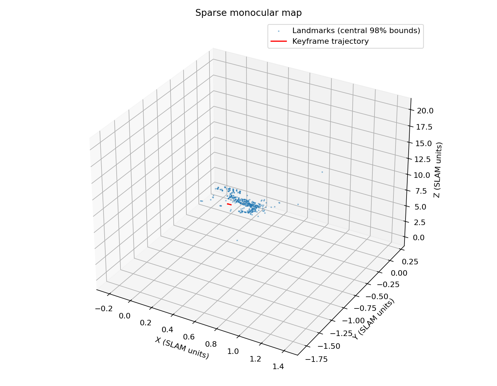

# Steadier desk recording

Recording: `1793499087071283100`, 450 frames. The same webcam calibration and
SLAM settings were used as the preceding room trial.

- Live pose available on 310/450 frames (68.9%, versus 66.6% on the previous best).
- First live pose at 6.22 seconds. Initialization also retained an earlier reference
  keyframe; its timestamp is not the live initialization completion time.
- Tracking was lost at frame 402 and did not recover before the recording ended.
- Final map: 7 keyframes, 435 finite landmarks, 1,343 validated observation links.

Sampled frames look sharper than the previous room recordings. However, much of the
scene is a laptop display showing a changing recursive live preview. Such content
does not satisfy the static-scene assumption of feature-based SLAM and may contribute
to errors. Limited parallax or calibration uncertainty may also contribute; no
controlled experiment isolated the cause. Pose availability is not an accuracy score.

## Fusion outcome

Fusion did **not** produce a dense map. Four keyframes failed because refinement
could not retain a positive inverse-depth scale, indicating insufficient agreement
between predicted depth and these SLAM landmarks. Three other keyframes had fewer
than 40 visible observed landmarks. No quality thresholds were relaxed to force output.

The failure happened before the optional conservative quality gate could accept
any frame. Turning off that gate alone would not solve this failure.

The per-keyframe failure report is saved at `data/fusion_webcam_desk/report.json`.
The sparse map and tracking log are in `data/slam_webcam_1793499087071283100/`.
No trajectory accuracy can be measured without ground truth, and no metric scale
is known. The previous room recording remains the available dense-fusion example.

Before another controlled capture, remove changing screen content from view or
display one fixed image. Keep multiple static objects at different depths visible
and translate sideways with modest rotation. Existing calibration can be reused if
camera resolution and focus remain the same.
