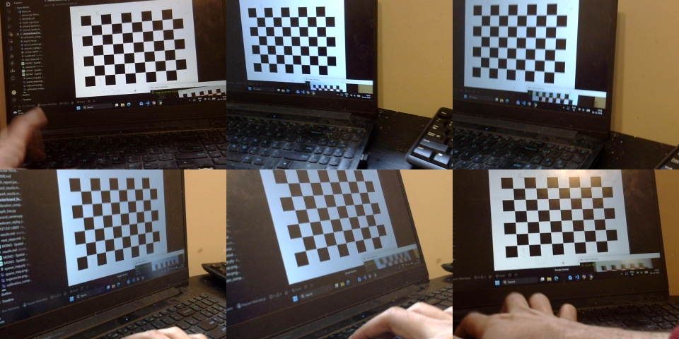

# Fresh webcam calibration validation

31 freshly collected 640x480 DirectShow checkerboard views; 9x6 inner corners,
square size 1 in arbitrary units. All 31 boards detected. Candidate saved separately
at `data/calibration_validation_live_01/candidate.npz`; active calibration and SLAM
profiles were not changed.

Candidate training RMS is 0.130 px. Focal lengths changed from approximately
952/952 px to 939/941 px (about 1.4%/1.1% lower); principal point changed from
(323.0,247.1) to (313.4,244.2). Different estimated coefficients alone do not
establish improved physical calibration.

Four-fold validation compares each candidate refit, trained on 23 or 24 fresh views,
against the frozen old calibration on the same held-out fresh images. Board pose
is fitted separately for every test view under each calibration.

| Fold | Fresh held-out views | Existing calibration RMS | Candidate refit RMS |
|---|---:|---:|---:|
| 1 | 8 | 0.195 px | 0.197 px |
| 2 | 8 | 0.114 px | 0.110 px |
| 3 | 8 | 0.104 px | 0.114 px |
| 4 | 7 | 0.105 px | 0.109 px |

The existing calibration explains these fresh views about as well as the candidate.
There is no evidence here of a large calibration change, nor a reason to replace
the active calibration automatically. This does not certify metric accuracy or
rule out focus changes during room recording, rolling shutter, screen flatness /
pixel geometry, weak edge coverage, or model limitations. Focus controls report
unsupported; automatic exposure was requested, but driver readback is unsupported.

Next investigate initialization robustness and camera-motion degeneracy on the
saved failing room footage, using unchanged calibration and both successful and
failed sessions as controls. Do not weaken fusion checks or replace the depth model
based on this calibration result. No new webcam recording is required for that work.

[Numerical comparison](comparison.json). This validation used fresh images against
the old model and held-out candidate refits, not candidate training RMS alone.
