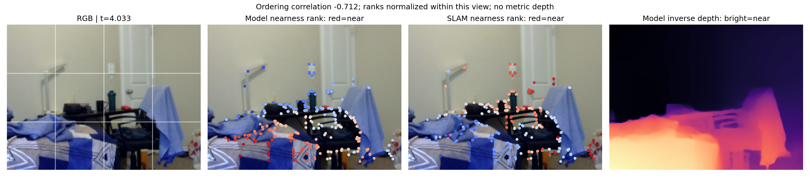

# Object-level inspection of the webcam depth disagreement

Session `818d5311fda343eab93f617e25ea9b71`; final optimized SLAM map.
Three uniformly selected retained keyframes were inspected with fresh 224x168
Depth Anything V2 Small inference. No fusion gates or model weights were changed.

## Main finding

The saved SLAM geometry reverses the visually apparent foreground/background
ordering of the bed and rear wall. The model's ordering for this pair looks
plausible. This makes the SLAM geometry and its calibration/initialization the
next debugging target; replacing the depth model is not currently justified by
this pair. Visual inspection is not a measured depth reference and does not
establish that all model pixels are correct.

The two middle panels use the same per-view rank convention: red means nearer,
blue means farther. Ranks are computed over the same projected sparse samples.
The last panel is raw relative inverse-depth prediction: bright means nearer.

Diagnostic rectangles were chosen manually after viewing the first frame:

| Region | Sparse samples | Median model nearness rank | Median SLAM nearness rank | Median SLAM z |
|---|---:|---:|---:|---:|
| Foreground bed | 84 | 87.5th percentile | 12.0th percentile | 1.719 |
| Rear-wall switch | 11 | 10.3rd percentile | 88.7th percentile | 0.605 |
| Upper rear door | 5 | 26.1st percentile | 96.8th percentile | 0.528 |

SLAM puts the rear-wall switch at about one third the bed's camera-axis depth.
This conflicts with the apparent room layout and is consistent with the negative
ordering correlations. Z is in arbitrary units, not meters. Rectangles are not
object masks or an independently held-out evaluation; the door sample is small.
Exact coordinates and values are in [manual_regions.json](manual_regions.json).

## Additional checks

The three inspected webcam views have ordering correlations of -0.712, -0.686 and
-0.634. The earlier eight-view audit and fixed stronger-parallax subsets also
remain negative, so the contradiction is not restricted to one small image area.
The first view has a 0.79 px median internal reprojection residual despite this
ordering reversal. Low reprojection error alone cannot certify correct 3D geometry.

The runner log records an initial 50-point map, tracking loss/reset, and a subsequent
74-point initialization. This is evidence of startup instability, not proof that
initialization alone caused the wrong geometry. Matching the saved calibration to
the YAML only verifies configuration consistency; physical calibration/focus/field
of view may still be wrong.

As a plotting/inference positive control, the same script ran on three retained
TUM views with their own calibration and geometry. Correlations were +0.911,
+0.960 and +0.888. Artifacts are in
`docs/fusion_diagnostics/tum_dataset_trial/spatial`. Thus the negative webcam result
is not a universally reversed color scale or globally inverted model convention.

## Next correction experiment

Rerun SLAM on the same archived webcam images while preserving this result as a
negative control. Compare a stricter initialization profile with the existing
profile on identical input, then reevaluate the same object regions, tracking
coverage and held-out depth agreement. Do not select geometry solely for matching
the depth model: add a measured foreground/background reference or held-out
calibration check to establish physical correctness. If a stricter initializer
cannot initialize, report that coverage loss rather than silently relaxing gates.

Also verify that the saved camera calibration corresponds to the current camera
mode/focus. A valid calibration for another optical setup can still produce wrong
geometry even when both software modules read the same numbers.

Reproduction uses `python -m eval.inspect_depth_ordering` with `--dataset`, `--slam`,
`--calibration` for webcam input, and a fresh `--output` directory. It reads saved
images only and preserves all original maps. Numerical outputs:
[spatial diagnostics](spatial_diagnostics.json), plus per-view NPZ arrays.

Other views: [middle](view_4.png), [last](view_8.png).
