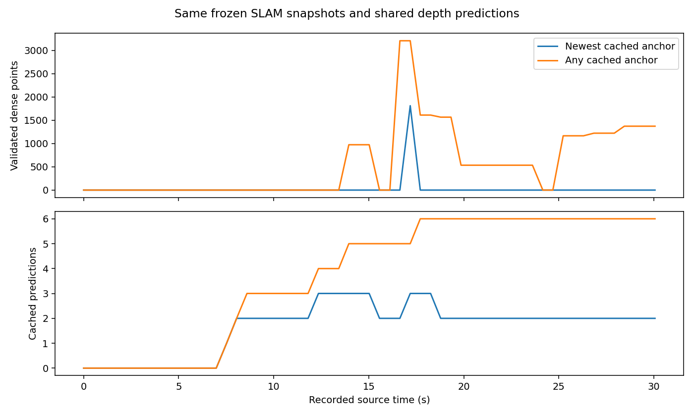

# Multiple-anchor candidate selection: fixed-state comparison

Implemented candidate selection against any currently cached keyframe, rather than
only the newest cached keyframe. A candidate must still satisfy the original shared
landmark and median ray-angle requirements relative to at least one anchor. Log
entries identify the anchor that permits evaluation. The chronological watermark
still prevents repeatedly inferring old evicted views. Fit, sharpness, cross-view
consistency and free-space checks are unchanged.

## Frozen-state experiment

One new SLAM execution consumed all 448 saved input images of session
`1fbb44b27fc94a4daf7afc48883dc708`, using strict initialization and existing webcam
calibration. Every eighth reply and the final reply were saved, yielding 57 snapshots.
Both policies then consumed these exact snapshots in order. SHA256 of resized image
pixels caches one 224x168 model prediction for reuse by either policy. Fourteen
unique predictions were calculated and saved. There is no separate SLAM execution
per policy and no variation in predictions for a shared image.

| Result | Newest anchor | Any cached anchor |
|---|---:|---:|
| Snapshots / posed snapshots | 57 / 43 | 57 / 43 |
| Snapshots with validated dense points | 1/57 | 27/57 |
| First supported dense window | 17.18 s | 13.95 s |
| Prediction-cache admission events | 5 | 14 |
| Maximum prediction cache | 3 | 6 |
| Maximum validated dense points before combined-map voxelization | 1,812 | 3,207 |

This establishes that the newest-only selection restriction reduced supported
dense coverage on this particular frozen trace. The new policy evaluates more
candidate views; it does not force their acceptance. Its extra nine prediction
admissions have a real compute cost that this shared-cache experiment does not
measure as live latency. At most one new prediction per output, eight cached views
and four active accepted views remain enforced and were checked on these artifacts.



## Limits and activation

This is one saved-input trace with a fixed snapshot sampling schedule, not a new
physical-webcam test or reconstruction accuracy measurement. The trace differs
from the original live run. Shared inference caching makes per-policy timing
comparisons invalid. More retained points and more passing outputs do not prove
independent depth accuracy or correct geometry across scenes. Failed initialization
can still produce no valid map; this change does not solve that problem.

The live window now defaults to `all_cached`; the `newest` policy remains available
in the comparison harness/class for regression checks. New worker processes load
the changed code without changing camera calibration or the strict server profile.
No new physical-camera recording was started automatically.

All 67 Python tests passed, including a synthetic case where the newest
anchor blocks a useful candidate that an older anchor supports, and existing
contradictory-depth, pose correction, map-reset and cache-bound checks.

## Reproduce

Use a new output directory:

```powershell
python -m eval.compare_keyframe_selection --dataset data/sessions/1fbb44b27fc94a4daf7afc48883dc708/slam_input --output data/selection_policy_comparison_repeat
```

To reuse the exact trace, also pass
`--trace data/selection_policy_comparison/snapshots.jsonl`.
Artifacts: [summary](measurements.json),
`data/selection_policy_comparison/{snapshots.jsonl,newest.json,all_cached.json,predictions}`.
Next verify the extra prediction cost and coverage in a controlled live recording.
