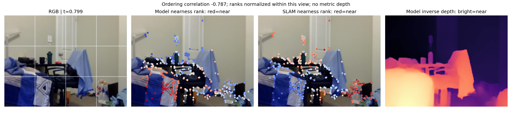

# Strict initialization: unsuccessful live repeat

Session `9631f3ef775d45c8b0ca37970ba2e2e5`, 30 seconds, DirectShow 640x480,
CPU depth 224x168, strict initialization and validated keyframe window. The new
candidate/removal instrumentation is present. This is a physical-camera recording.

| Measurement | Result |
|---|---:|
| Outputs / outputs with poses | 140 / 72 |
| First pose | 13.55 s |
| Dense-window outputs | 0 |
| Final sparse map points | 719 |
| Receipt-to-packet median / p95 | 261 / 350 ms |
| Misses of 500 ms budget | 2/140 |

Four keyframe predictions were cached during the session. Every reported fit
failed with a nonpositive inverse-depth scale (194 per-keyframe/output reports,
not 194 independent frames or unique keyframes). There were 38 candidate skip
events for insufficient shared landmarks/parallax and one cached keyframe removal
because its identity was absent from the active-map snapshot. No removal was
attributed to the metadata-window limit or prediction-cache capacity.

Thus metadata/cache churn is not the main explanation for this repeat: none of
the evaluated views had an acceptable depth fit in the first place.

Fresh inference against three sampled final optimized keyframes still gives
ordering correlations -0.787, -0.710 and -0.786. The first spatial overlay again
shows SLAM placing the rear wall ahead of the foreground bed, while model ordering
is visually plausible. Internal median reprojection residuals of 0.61–0.69 px
do not establish physically correct scene geometry.

## Conclusion

The previous strict-profile success did not repeat. A 2-degree initialization
threshold is not a reliable correction. Faster timing here is not a quality
improvement: this run did no accepted dense fusion. Keep fusion rejection enabled.
The remaining causes include calibration/optical mismatch and initialization or
motion degeneracy; this evidence does not uniquely isolate one.

Next verify current webcam intrinsics against held-out checkerboard views captured
in the current optical mode, and test initialization sensitivity on saved footage
against recognizable foreground/background constraints. Avoid another blind live
recording or threshold relaxation. A smaller model is not an established fix.

[Recorded decision summary](measurements.json),
[spatial diagnostics](spatial/spatial_diagnostics.json). Original data preserved at
`data/sessions/9631f3ef775d45c8b0ca37970ba2e2e5`.
