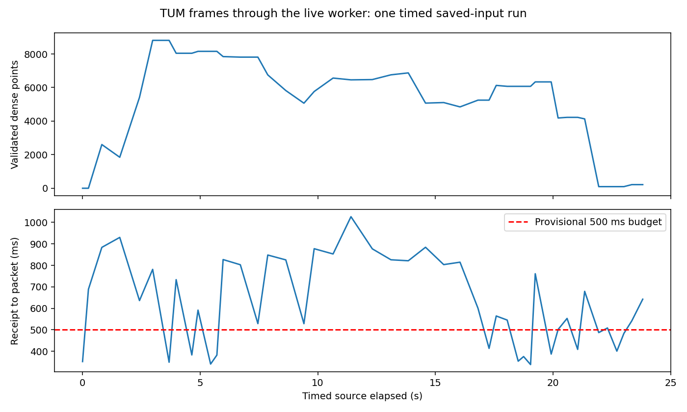

# TUM frames through the live worker

One 24-second timed saved-input trial, with Depth Anything V2 Small at 224x168,
CPU, lossless raw transport and the validated active-keyframe window enabled.
Original TUM RGB frames were released at their recorded timestamp intervals into
the latest-frame capture slot. SLAM ran anew; final poses were not supplied.
The same live worker, SLAM feeder, depth alignment and window code ran as for the
webcam. This replaces acquisition only; it is not a physical-camera latency test.

## Results

| Measurement | Result |
|---|---:|
| Processed outputs | 46 |
| Outputs with current camera poses | 45/46 (97.8%) |
| Outputs with a supported dense window | 44/46 (95.7%) |
| Exact output image / SLAM frame matches | All |
| Peak dense points before final combined-map sampling | 8,810 |
| Final dense window points | 217 |
| Final combined sparse/dense snapshot | 1,567 points |
| Maximum prediction cache / active window | 8 / 4 keyframes |
| Receipt-to-packet p50 / p95 | 596 / 884 ms |
| Misses of provisional 500 ms budget | 32/46 |
| Skipped source capture sequences | 669 |

The final two contributing keyframes have held-out mean depth disagreement of
4.46% and 5.43% against SLAM; two other final cached keyframes fail depth ordering.
These are selected accepted-view measurements, not accuracy for all frames or
ground truth. The window's dense count varies as views/poses/support change;
44 dense outputs do not imply 44 independently validated reconstructions.

## What this resolves

The live scheduling and active-window implementation can produce supported dense
mapping on dataset input using the correct camera profile. Failure of the latest
webcam clip is therefore not inevitable merely because processing is live.
However, some dataset keyframes still fail and latency is substantial. The clip,
calibration, source frame rate, motion and resulting map differ from the webcam
trial; this is not an isolated causal or performance comparison. One short run
does not establish reliability. Mapping remains bounded, partial and arbitrary-scale.

## Implementation and safeguards

The live bridge now accepts an explicit calibration/configuration pair and forwards
the selected YAML profile to the existing WSL runner. Worker geometry uses that
same calibration. Existing webcam defaults are preserved. Calibration/profile
mismatches are rejected before launching SLAM. The timed harness's `--tum-profile`
option accepts only the local original TUM xyz sequence and writes a separate
trial calibration; it never overwrites webcam calibration. Runs must end before
source exhaustion, avoiding repeated final frames in a trial.

63 Python tests passed, including mismatch rejection and selected-profile forwarding.

## Reproduce

Choose a fresh output directory:

```powershell
python -m eval.timed_live_pipeline --dataset data/rgbd_dataset_freiburg1_xyz --duration 24 --output data/tum_live_path_trial_repeat --depth-width 224 --keyframe-map --tum-profile
```

No physical camera is acquired. Raw artifacts are in `data/tum_live_path_trial`.
[Measurements](measurements.json) include the final per-keyframe rejection details.



Next: inspect object-level projected correspondences in the saved webcam sequence,
using this dataset as a positive control. Do not weaken quality checks to obtain points.
