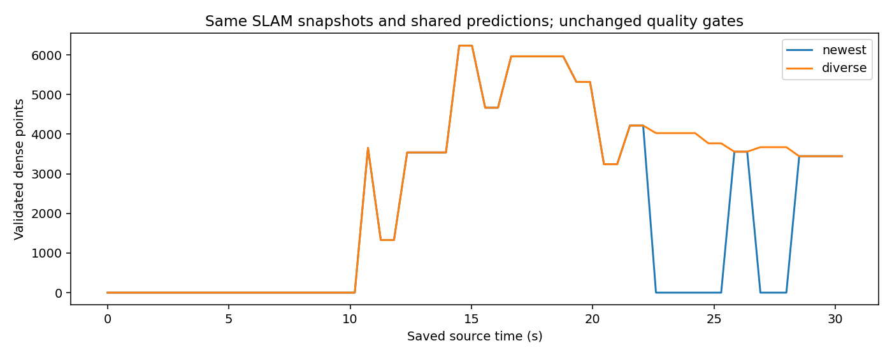

# Geometry-diverse bounded active window

The live window previously selected only the newest four accepted depth views.
It now reserves a geometrically supported pair from accepted cached views, then
fills remaining slots with recent accepted views. Pair score is shared-landmark
count times median estimated ray angle capped at five degrees; eligibility still
requires the existing shared-landmark and angle thresholds. This is a geometry
heuristic, not a calibrated uncertainty or accuracy estimate.

The window still holds at most four views from eight cached predictions. All
views are refitted/rebuilt using current geometry, and the unchanged per-point
cross-view and free-space checks determine which points are emitted. Old clouds
are not retained when their updated geometry fails validation. No held-out depth
errors are used to choose the reserved pair.

## Identical-state comparison

One fresh strict-profile SLAM run processed all 451 saved frames from recording
`a934304385684437bed057244f50eee1`. Every eighth reply plus the final reply was
frozen. Both window policies consumed these same 58 snapshots and the same 16
unique pixel-hashed 224x168 depth predictions. Candidate selection used the same
multiple-anchor policy in both cases.

| Measurement | Newest four | Geometry-diverse four |
|---|---:|---:|
| Snapshots / posed snapshots | 58 / 40 | 58 / 40 |
| Snapshots with validated dense points | 29 | 38 |
| First dense output | 10.74 s | 10.74 s |
| Keyframe prediction admissions | 16 | 16 |
| Maximum prediction cache | 7 | 7 |
| Peak dense points before combined-map voxelization | 6,233 | 6,233 |

This improves coverage on the same frozen geometry without additional prediction
admissions in this test. It does not improve initial dense startup time here.
Pair scoring adds CPU work, and shared inference caching prevents treating these
replay durations as live latency measurements.



The trace is from a fresh saved-input execution, not the exact historical live
snapshots, and represents one scene. Higher coverage does not prove independent
map accuracy or solve initialization ambiguity. A live repeatability check remains
necessary; no camera acquisition was started automatically.

The `diverse` window is enabled by default for new workers. The prior `newest`
policy is retained for evaluation. All 68 Python tests passed, including geometry
diversity selection, contradictory-depth rejection, pose/scale rebuilding, cache
bounds, culling and map resets. Original maps and calibration were preserved.

Reproduce using a fresh output directory:

```powershell
python -m eval.compare_keyframe_selection --dataset data/sessions/a934304385684437bed057244f50eee1/slam_input --output data/window_diversity_repeat --compare-windows --trace data/window_diversity_comparison/snapshots.jsonl
```

[Measurements](measurements.json). Raw snapshots, per-policy outputs and shared
predictions are under `data/window_diversity_comparison`.
