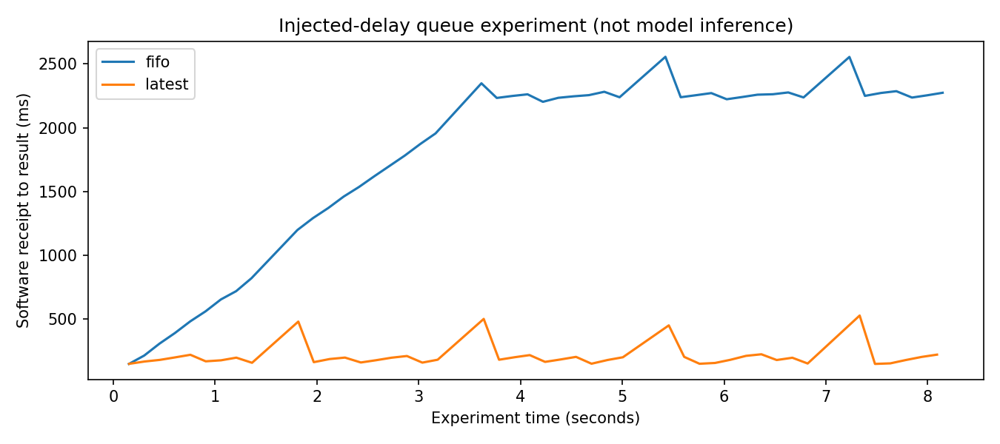

# Live perception freshness: first measured baseline

Active scope: local webcam/depth/dashboard timing. Gazebo is excluded. Full live
SLAM/fusion and reliable room reconstruction remain unfinished.

## Live path

The separate capture thread keeps the latest frame. The inference worker records
input age, software capture receipt to JPEG readiness, skipped capture sequences,
output intervals, p50/p95/p99, and deadline misses. The timing includes RGB/depth
file writes and JPEG encoding, but stops before state serialization/IPC. The API
also measures capture receipt to WebSocket-send initiation using the same host's
monotonic clock. Browser packet assembly to image-load time is reported separately.

These values do **not** establish sensor-exposure-to-screen latency. Hidden driver
buffers, network transit, browser paint and display hardware are not measured.
No subtraction of unsynchronized browser/server clocks is used. Output jitter is
absolute output-interval deviation from its median, not spatial depth instability.
The provisional 500 ms deadline is an engineering demonstration budget, not a
robot control requirement or safety guarantee.

Live summaries include cold first inference and startup camera frames; model
loading precedes camera acquisition. Each session saves `timing_summary.json`.
Replay cannot turn these measurements into live timing. Auto exposure is explicitly
requested for dashboard capture; driver support/readback still varies.

## Actual webcam/depth/browser smoke tests

Both tests used DirectShow, CPU fp32, 640x480 capture, eight-second acquisition,
and a real Chrome dashboard with saved relative-depth overlays.

| Depth input | Outputs | Receipt → JPEG p50 | p95 | p99 | >500 ms | Output jitter p95 |
|---|---:|---:|---:|---:|---:|---:|
| 320x240 | 9 | 1019.7 ms | 1148.5 ms | 1181.3 ms | 9/9 | 162.7 ms |
| 160x120 | 18 | 454.8 ms | 736.3 ms | 800.9 ms | 5/18 | 294.5 ms |

The smaller input had lower observed age but still missed deadlines; jitter did
not improve in these runs. Nine/eighteen outputs are far too few to characterize
p99 reliably. These are smoke-test observations, not a controlled performance
claim: background load, lighting, and power mode were not controlled, and only one
successful run per setting is reported. One additional QA attempt was interrupted
by another test and was excluded; the 160 run above completed in isolation.

Raw summaries: [320](live_320.json), [160](live_160.json). Browser tests observed no
page errors. Camera capture, saved depth, timing fields and depth-overlay delivery
were verified; physical display latency was not.

## Isolated queue experiment

The experiment emits synthetic frame tokens at 15 Hz into actual wall-clock
producer/consumer queues. A consumer sleeps 150 ms, plus an injected 300 ms stall
every tenth output. Both policies run for eight seconds without draining pending
frames. FIFO capacity is 32, dropping oldest on overflow; latest capacity is one.

| Policy | Result-age p50 | p95 | p99 | >500 ms | Overwritten tokens |
|---|---:|---:|---:|---:|---:|
| Bounded FIFO | 2235 ms | 2332 ms | 2555 ms | 41/46 | 43 |
| Latest | 184 ms | 476 ms | 518 ms | 2/45 | 74 |

This demonstrates a freshness/drop tradeoff, not faster inference or eliminated
processing jitter. It is **not measured camera/model/network performance**.
The inner generic summary's skipped-capture count is unused in this token test;
use the explicitly reported overwritten/pending counts instead.

Reproduce with `python -m eval.freshness_benchmark`; [raw report](queue_report.json)
includes capacities, pending tokens, parameters, platform and every output sample.

## Resolution tradeoff on saved views

Thirty CPU timing samples per size used the same five selected room keyframes,
repeated six times with rotating variant order. One warmup per size was excluded.
Quality uses identical per-view sparse training/held-out samples. Unlike the live
test, these timings cover only `DepthEstimator.predict`, excluding explicit input
resize, storage, capture and browser. Do not compare the two timing scopes directly.

| Input | Model p50 / p95 | Successful fits | Valid held-out samples | Mean relative SLAM disagreement |
|---|---:|---:|---:|---:|
| 160x120 | 246 / 485 ms | 2/5 | 199 | 6.69% |
| 224x168 | 396 / 737 ms | 3/5 | 295 | 8.80% |
| 320x240 | 699 / 1349 ms | 5/5 | 491 | 4.12% |

The quality means have different coverage because fits fail at smaller sizes.
They are not equal-input accuracy rankings; failures are part of the result.
SLAM agreement is not independent sensor accuracy. This small, selected scene
does not establish generalization. Keep 320 as the default; smaller inputs are
explicit selectable options for preview-speed experiments. [Raw report](depth_tradeoff.json).

Reproduce with `python -m eval.depth_tradeoff` using the existing cached model and
recording. Hardware identifier, PyTorch thread count, precision and scope are saved.
No neural weights were trained or changed.

## Use the dashboard

Restart the backend to load new worker/API code, hard-refresh the page, choose
New recording and enable relative depth. Select input size before starting.
The Live freshness panel displays latency tails, deadline misses, skipped frames,
output jitter and server-send age. The decoding measurement has a separate scope.
Do not expect a live SLAM pose or growing 3D map.

44 Python tests, four JavaScript protocol tests, browser regressions and actual
hardware smoke checks passed. Next work is longer repeated runs, controlled-load
comparisons and alternative inference runtimes. Temporal depth consistency and
independent geometric accuracy still require dedicated evaluation.
