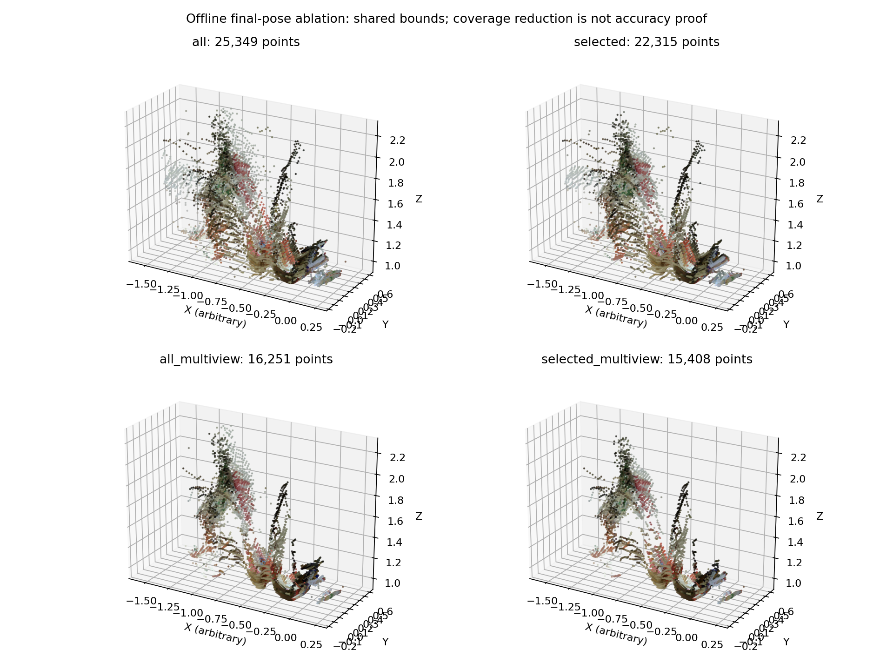

# Paired keyframe-selection and cross-view fusion experiment

The successful physical-webcam scan (`79c2df1975674ee6bfce9c3f2bad374f`) and
rejected window scan (`93601a495a6147a88e625fa1f03345c9`) were evaluated with the
same model, inference size, selection policy and fusion acceptance checks.
Original recordings, maps and live settings were preserved.

## Fixed experiment

- Depth Anything V2 Small, CPU fp32, 224x168 input.
- All retained keyframes from each final optimized map: 16 successful, 8 rejected.
- Identical per-view predictions, robust fits and random training/held-out splits
  reused across all four variants. No refitting after selection or pixel filtering.
- Selection uses image sharpness at 320x240 (Laplacian variance >=50), at least
  70 shared landmarks and median shared-ray angle >=1 degree relative to the
  previously selected keyframe. A seed still needs another view for dense support.
- Existing positive-scale fit, training-support, rank-correlation and hull/range
  gates remain unchanged. Selection does not inspect held-out depth errors.
- Cross-view checking requires another accepted view, >=1 degree ray angle and
  <=10% depth disagreement. Free-space contradictions reject a point; occlusions
  and unknown pixels do not count as supporting observations.

The selection thresholds are fixed engineering heuristics, not calibrated confidence
or safety guarantees. The geometry comes from estimated SLAM poses, not measured
camera movement. These are two known examples, not an unseen validation set.

## Results

The successful scan had 14/16 depth-supported views. Geometry/image selection
retained 13/16 candidate keyframes, of which 12 passed depth alignment checks.
The rejected scan selected 4/8 candidates, but **all eight original views failed
positive-scale alignment**, so no variant produced a dense map.

| Variant | Successful: supported views used | Dense points after voxelization | Rejected: dense points |
|---|---:|---:|---:|
| All accepted views | 14 | 25,349 | 0 |
| Selected accepted views | 12 | 22,315 | 0 |
| All accepted + cross-view checks | 14 | 16,251 | 0 |
| Selected accepted + cross-view checks | 12 | **15,408** | **0** |

Before voxelization, cross-view checks retained 64.1% of all-view candidates and
69.1% of selected-view candidates. Unsupported/free-space-conflicting points were
removed, not repaired. The rejected control fails before cross-view checking;
this is not evidence that the cross-view stage independently detects that failure.



The preview remains incomplete and shows spread surfaces. It is not a validated
full-room reconstruction. More or fewer points alone do not establish accuracy.

## Agreement versus coverage

Accepted-view held-out mean agreement was 9.03% for the all-view group and 8.47%
for the selected group. These numbers use different view coverage. Selection did
not improve the estimates for identical inputs: it removed views. Cross-view
filtering leaves the per-view fits and their held-out error numbers unchanged.
The scores are measured before dense filtering, not accuracy scores for the final
point clouds. The same landmark can be training data in one view and held out in
another; this is per-view agreement, not an independent landmark test set.

## What this validates

Follow-up: the [bounded live active-window prototype](../active_keyframe_window/results.md)
is now implemented as an opt-in mode, with measured additional latency.

The offline candidate can retain a supported subset from the successful scan
without forcing a dense map from the rejected scan. It is a useful regression
test for subsequent mapping changes, not proof of general reconstruction quality.
No live defaults were changed. Production currently shows a sparse map plus a
replaceable local dense preview; this experiment accumulates using final saved
keyframe poses and can use later views for confirmation.

The next implementation step is a bounded active keyframe window: preserve depth
in each keyframe's camera coordinates, validate it against other accepted views,
and rebuild the window when SLAM revises poses. Offline final-pose results cannot
be presented as live correction-aware mapping until that path is implemented and
its added latency is measured.

## Artifacts and reproduction

Summary and per-view decisions: [summary.json](summary.json),
[successful](successful.json), [rejected](rejected.json).

Point/color arrays are in `data/paired_fusion/successful/`:
`all.npz`, `selected.npz`, `all_multiview.npz`, `selected_multiview.npz`.
No dense map files are created for the rejected control.

```powershell
python -m eval.paired_fusion --output data/paired_fusion_trial_02
python -m eval.plot_paired_fusion --input data/paired_fusion_trial_02/successful --output docs/paired_fusion/comparison_trial_02.png
```

Use a fresh experiment directory; these commands process saved RGB and do not open
a webcam. 55 Python tests pass, including selection tests separating shared-feature
overlap from useful viewing-angle change and excluding blurred geometry anchors.
