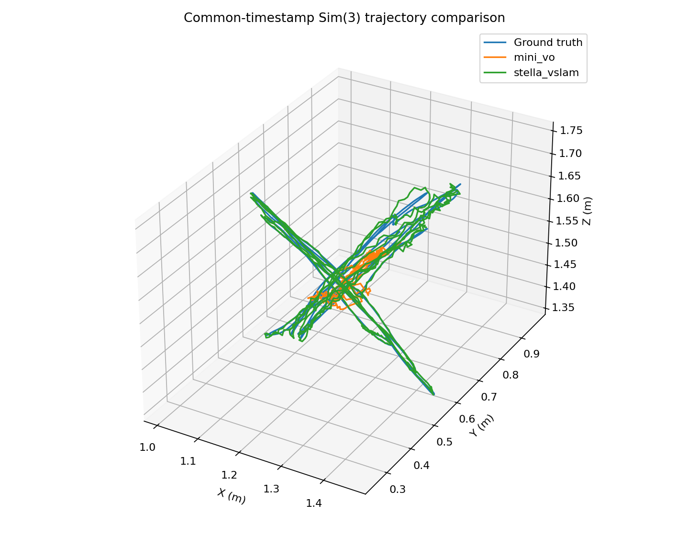
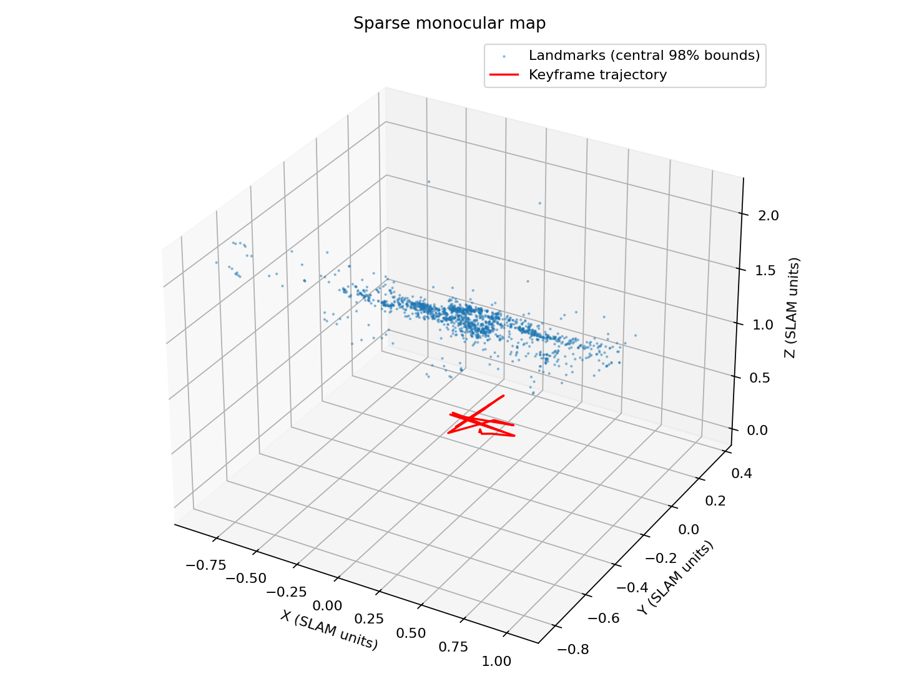

# Phase 4: established monocular SLAM

The dataset portion of Phase 4 is implemented and validated. Own-webcam SLAM remains
pending valid camera calibration and a raw recording.

Headless stella_vslam was compiled in the existing Ubuntu 24.04 WSL2 distribution.
It processed all 798 RGB frames of the original TUM Freiburg 1 XYZ sequence using
the same calibration as Phase 3. The algorithm received no dataset depth, IMU, or
ground-truth poses. Source versions and vocabulary hash are in
[`slam/source_versions.json`](../slam/source_versions.json).

| System | Common-pose ATE RMSE | Median error | p95 error |
|---|---:|---:|---:|
| Mini two-view VO | 0.16777 m | 0.13170 m | 0.28725 m |
| stella_vslam | 0.01058 m | 0.00786 m | 0.01955 m |

Both systems were independently Sim(3)-aligned on **795 common ground-truth
associations** within 20 ms. This is approximately 15.85x lower positional RMSE for
stella in this run. Results vary across runs because mapping and optimization are
multithreaded. Scale alignment does not recover real metric scale for deployment.
The built-in evaluator was used; an independent `evo` cross-check remains optional.

The mini VO emitted 798 poses (796 associated); stella emitted 797 poses
(795 associated). The runner obtained a live pose on 796 of 798 inputs. The two
unavailable inputs include initialization and must not be interpreted as two tracking
failures. stella's trajectory exporter can retain a reference frame from initialization,
so exported pose counts differ from live pose availability.

Tracking call latency was 21.2 ms median and 55.2 ms p95. It excludes image loading
and background map optimization costs; it is not total system latency. Phase 3 ran
in Windows Python and Phase 4 ran in WSL C++, so latency is not a controlled
implementation speed comparison.

Map validation found **19 keyframes, 1,555 finite sparse landmarks, and 8,556 valid
keyframe/landmark observation links**. World positions remain in arbitrary SLAM units.
The reusable map database, optimized trajectories, and CSV exports are in
`data/slam_fr1_xyz/`.

Comparison JSON/Markdown, map validation summary, and a portable PLY are in
[`docs/phase4/`](phase4/). Build and rerun instructions are in
[`slam/README.md`](../slam/README.md).

During setup, Ubuntu's existing interrupted Vim installation blocked apt. It was
repaired through apt's dependency resolver before installing build dependencies.
Compiled SLAM libraries are installed locally under `~/robot_sim_slam/install`, not
system-wide. Build scripts use two compiler jobs and apply the documented C++17
compatibility setting to the Linux build copy only.
