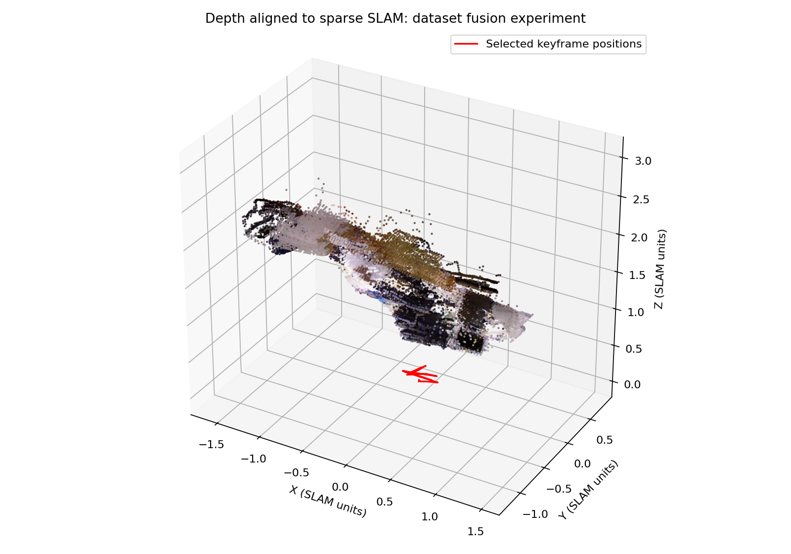

# Phase 5 foundation: dataset depth/SLAM fusion

An offline fusion pipeline now combines Depth Anything V2 Small relative inverse
depth with the optimized monocular SLAM map from Phase 4. This is a dataset experiment,
not a completed webcam room-reconstruction or robotics map.

| Measurement | Result |
|---|---:|
| Keyframes fused | 19 / 19 |
| Voxelized colored map points | 37,172 |
| Valid held-out sparse correspondences | 1,456 |
| Invalid held-out predictions | 0 |
| Mean held-out absolute relative depth error | 0.05149 (5.15%) |
| Median held-out absolute relative depth error | 0.02977 (2.98%) |

For each keyframe, only its observed, visible sparse landmarks are projected into
the image. When multiple points project into the same rounded pixel, the nearest
one is retained. Correspondences are split before fitting: 80% train and 20% held out.
The fit estimates `1 / SLAM_z = scale * network_output + shift` using positive-scale
RANSAC and relative-error weighted refinement. Training outliers are rejected;
held-out errors are evaluated without this rejection. Invalid held-out predictions
are counted explicitly. Splits are per keyframe: the same physical landmark may
appear in training in one frame and evaluation in another, so this is per-frame
held-out agreement, not a landmark-disjoint generalization test.

This evaluates agreement with a noisy SLAM map. It is **not independent sensor
ground truth**. No TUM depth images or ground truth were used for alignment.

Depth inference used 320x240 RGB input. Intrinsics account for image resizing;
distortion remains in the image and rays are undistorted during back-projection.
Camera-to-world poses transform points into the shared map. Dense depth is clipped
above 1.5 times the training sparse-depth 95th percentile to bound far extrapolation.
Points sampled every three pixels are accumulated and voxelized at 0.02 **SLAM units**.



The visible result is a coarse tabletop reconstruction with depth spread and outliers.
It should not be described as a clean watertight surface or a navigation-ready map.
Artifacts in `data/fusion_fr1_xyz/`: `dense_map.ply`, `dense_map.npz`, `dense_map.png`,
and per-keyframe `report.json`. PLY is portable to point-cloud viewers.

Rerun after Phase 4:

```powershell
python fuse_dataset.py --max-keyframes 20
```

Remaining Phase 5 work:

- Validate on a calibrated webcam room recording.
- Estimate or supply a ground plane before generating a floor-based occupancy grid.
- Obtain a real-world scale reference if metric distances are required.
- Evaluate temporal stability and depth errors on independent depth ground truth.

The fusion and comparison additions bring the automated suite to 16 passing tests.
