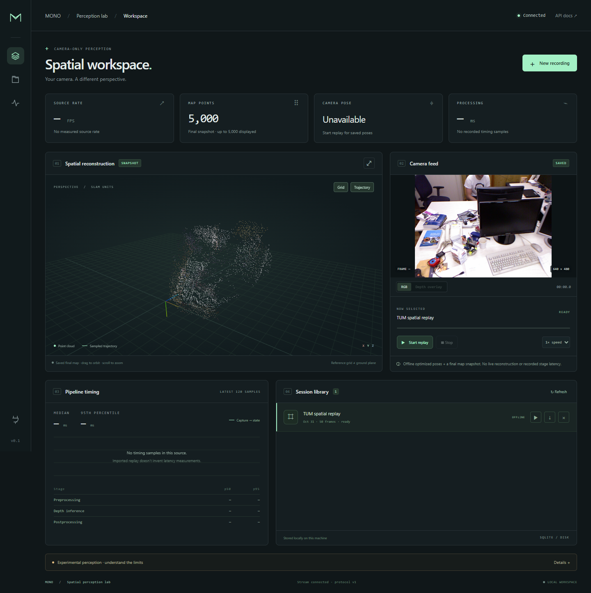

# Phase 7: local dashboard

Implemented a local dashboard at the backend root URL. It shares the API origin and
automatically uses the current server port, including 8001. The frontend consists of
browser JavaScript modules and locally bundled Three.js; no separate frontend
build/server is required. Hosting was explicitly declined in favor of local operation.

Features include RGB previews/replay, orbitable map snapshots, sampled trajectory
and camera frustum, session library, recording controls, start/stop replay, speed
selection, download/delete, optional saved depth overlay, measured latency plots,
and connection/reconnect state.

The initial saved snapshot and RGB preview load without starting capture. Live camera
access requires submitting the recording form. That request explicitly sets
`backend: dshow`. Imported replay is visibly labeled, missing measurements are shown
as unavailable, and saved maps are labeled snapshots. The UI does not imply live
SLAM, metric coordinates, floor estimation, or robot obstacle avoidance.

The backend now serves static dashboard assets after API routes, and provides:

- `GET /sessions/{id}/preview`: first saved RGB image.
- `GET /sessions/{id}/snapshot`: capped binary final point cloud plus point-count header.
- `GET /sessions/{id}/depth/{sequence}`: visualization of a saved relative-depth array.

Validation uses a separate local test server/session directory. Chrome browser QA
verified initial RGB/map preview, real process-based replay with poses, stop/restart
controls, DirectShow recording request construction (without opening a physical
camera in that test), depth overlay and timing display on an explicitly synthetic
fixture, session deletion, reconnect, desktop/mobile layouts, and WebGL-unavailable
fallback. No JavaScript page errors were observed. Mobile width 390 pixels had no
horizontal overflow. Point-cloud rendering was checked using Chrome's software WebGL.

Protocol unit checks cover ordered binary assembly, invalid lengths, nonfinite
geometry, and missing metrics. Python API tests cover root/assets, session previews,
snapshot byte sizes, and depth images in addition to existing backend tests.
All 30 Python tests and four JavaScript protocol tests passed, along with browser QA.

The screenshot uses actual TUM RGB, poses, and fused points in a 50-frame QA import.
It is a replay preview, not a live room reconstruction. Camera hardware testing was
performed in Phase 6; dashboard recording-form QA intercepts the request and checks
its content rather than claiming another physical camera recording.

An already-running server must be restarted to load the new FastAPI routes. API
documentation remains available at `/docs`. See [dashboard instructions](../frontend/README.md).
