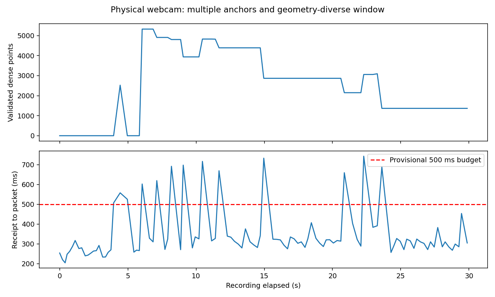
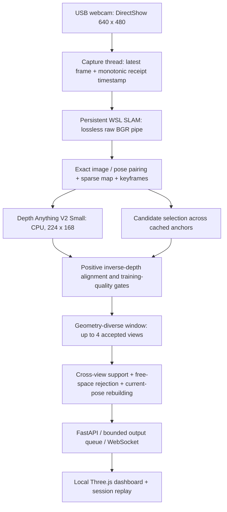
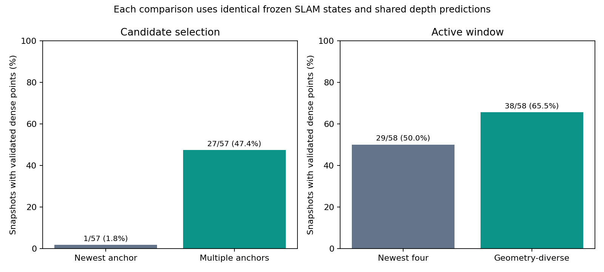

# Camera-only perception: project engineering report

**Author: Rayyan. Evidence cutoff: November 1, 2026.** This report documents my work from the implementation
guide through the successful physical-webcam session
`fdcaebe047df439fa60dd00f6e0586c4`. This consolidates historical reports; their
“not yet implemented” statements describe their respective milestones.

## 1. Outcome

I built a system on a Windows laptop with one USB webcam that supports live relative-depth estimation,
monocular SLAM, a bounded cross-view-validated dense point-cloud window, and a
local dashboard with recording, replay and measured freshness. Processing uses
CPU inference and a persistent C++ SLAM process in Ubuntu WSL2. I integrated pretrained
depth weights and established SLAM rather than training a new model.

The final 30-second demonstration initialized SLAM at **3.95 seconds**, produced
validated dense output at **4.43 seconds**, and retained current poses on all
**84 processed outputs after initialization**. Of those, **79/84 (94.0%)** had
validated dense points. Across the entire recording, including initialization,
that is **79/103 (76.7%)**. The final combined sparse/dense snapshot contains
**1,671 points**. Capture-receipt-to-packet latency was **310 ms median, 687 ms p95**.

This establishes a working perception prototype. It does not establish complete
room reconstruction, metric depth, navigation, independent dense-map accuracy,
production reliability or robot-control suitability. Tail latency remains unresolved.
[Final session evidence](successful_live_session/diverse_window/report.md).

## 2. Original objective and final scope

The original *Monocular Perception + SLAM + Full-Stack Robotics Implementation
Guide* proposed camera capture, calibration, monocular depth, visual odometry,
established SLAM, depth/pose fusion, a dashboard and simulated obstacle avoidance.
It assumed one webcam without stereo, depth hardware or an IMU. I used the guide as a starting point, then adjusted the scope as I evaluated the system.

I focused the final deliverable on perception, evaluation, freshness and the
dashboard. I explored Gazebo/ROS, then removed them from active scope.
I do not claim that the simulated three-block world represented the
recorded room, or that a simulated robot navigated using the room reconstruction.

Monocular SLAM supplies consistent **arbitrary scale**, not meters. Aligning a
depth network to monocular landmarks cannot independently recover metric scale.
This corrects the original guide's informal “metric-ish” description.

## 3. Final architecture and operating assumptions

The model estimates relative inverse depth. Fusion fits
`1 / SLAM_z = a × model_prediction + b`, requiring a positive scale. Predictions
are back-projected with calibrated, undistorted rays and transformed using
camera-to-world poses. Pose or scale updates rebuild camera-local geometry instead
of accumulating old world-space clouds.

The active cache holds up to **8 predictions**, the dense window up to **4 accepted
views**, and admission performs at most **one new keyframe inference per output**.
The dashboard transmits/displays at most **5,000 sampled map points**; that display
cap is not a measurement of full map size. Replay uses a saved final snapshot,
not a reconstruction of historical growing clouds.

Core implementation: [capture](../perception/capture.py),
[depth](../perception/depth.py), [SLAM bridge](../perception/live_slam.py),
[fusion](../perception/fusion.py), [active window](../perception/keyframe_window.py),
[worker](../backend/worker.py), [dashboard](../frontend/README.md).

## 4. Development stages, problems and actions

### Capture and trustworthy timestamps

**Problem:** frame age could grow while a slow consumer continued receiving frames.
FPS alone did not reveal stale observations. Webcam driver settings were also
inconsistent: DirectShow was required, and focus/buffer controls reported unsupported.

**Action:** I implemented a separate capture thread that retained the latest frame, attached sequence
IDs and monotonic software-receipt timestamps, and exposed skipped frames. Bounded
queues prevented a slow browser from accumulating perception history. Actual
requested/reported camera properties were preserved in session metadata.

**Measured queue experiment:** a synthetic 15 Hz producer, 150 ms consumer and an
extra 300 ms stall every tenth output compared FIFO capacity 32 with latest-only
capacity 1. Result age changed from **2,235 to 184 ms median**, **2,552 to 518 ms p99**;
500 ms misses changed from **41/46 to 2/45**. This demonstrates a freshness/drop
tradeoff on synthetic tokens, not a measured camera speedup. The system deliberately
skips inputs rather than promising to process every captured frame.
[Freshness results](latency/results.md).

### CPU depth estimation and the speed/quality tradeoff

**Problem:** full-resolution monocular depth was too expensive on the available CPU.
Changing resolution also changed geometric support, so selecting solely on FPS
would hide quality loss.

**Action:** I wrapped the cached pretrained Depth Anything V2 Small model, measured
preprocessing/inference/postprocessing, separated warm-up, and evaluated smaller
inputs before considering different weights. Network dimensions round to multiples
of 14; requested image size and actual tensor size were recorded separately.

| Early fixed-input CPU benchmark | Throughput | Wrapper median / p95 |
|---|---:|---:|
| 320×240 | 4.50 FPS | 218.6 / 266.6 ms |
| 480×360 | 1.57 FPS | 584.0 / 776.1 ms |
| 640×480 | 0.69 FPS | 1,379.3 / 1,706.0 ms |

These used 100 measured frames after three warm-ups, with zero camera read failures.
They measure the depth wrapper, not the full live pipeline. GPU comparison was
unavailable in the installed CPU-only PyTorch configuration.
[Depth baseline](phase2_results.md).

A later fixed-five-keyframe study with identical sparse associations found:

| Input | Model p50 / p95 | Pooled held-out SLAM disagreement | Training-supported views |
|---|---:|---:|---:|
| 160×120 | 85 / 90 ms | 11.68% | 3/5 |
| 224×168 | 149 / 159 ms | 8.49% | 5/5 |
| 320×240 | 303 / 379 ms | 8.12% | 5/5 |

This motivated **224×168** for subsequent live trials. The study is small and uses
final optimized geometry; it is not independent accuracy or a universal optimal
resolution. Other earlier experiments had different subsets and timings and are
not pooled into this table. [Study and caveats](successful_live_session/next_steps.md).

### Educational VO versus established SLAM

**Problem:** the custom two-view visual odometry baseline drifted, lost motion
steps and used unit translation steps without recovering relative step scale.

**Action:** I retained it as a baseline and integrated pinned stella_vslam in WSL,
exporting trajectories, sparse landmarks, observations and reusable maps.

| TUM Freiburg 1 XYZ, 795 common reference associations | Sim(3)-aligned positional ATE RMSE |
|---|---:|
| Educational VO | 0.16777 m |
| stella_vslam | 0.01058 m |

This is approximately **15.9× lower aligned trajectory error on that sequence**.
The established runner obtained current poses on **796/798 inputs**. Reference
poses were used only for evaluation. Similarity alignment resolves scale for that
evaluation; the deployed monocular map remains arbitrary-scale. It is camera-path
accuracy, not dense surface accuracy. [Common-timestamp comparison](phase4_results.md).

### Webcam calibration and fresh validation

**Problem:** TUM calibration could not be reused for a different webcam. A ruler or
known checkerboard square size was initially unavailable, and focus locking was
unsupported by the driver.

**Action:** I collected a 9×6-inner-corner checkerboard displayed on a laptop, saved
640×480 calibration using arbitrary square units, and rejected camera-profile
mismatches before launching SLAM. Original calibration training RMS was **0.106 px**.

Later, **31 fresh checkerboard views** tested whether the optical setup had changed.
The candidate trained at **0.130 px RMS**. Four-fold fresh-view validation gave
**0.104–0.195 px** for the frozen original calibration and **0.109–0.197 px** for
candidate refits. The active calibration was retained: the candidate did not clearly
improve fresh-view residuals. This argues against a large mismatch in the sampled
views, without ruling out focus variation, screen geometry or distortion outside
sampled areas. [Validation](fusion_diagnostics/calibration_live_validation/results.md).

### Why an attractive point cloud was insufficient

**Problem:** the first room fusion produced many points but inconsistent geometry.
Three initial recordings obtained pose availability of **0%, 8.0% and 66.6%**.
The best early map fused **74,325 points from 10/15 keyframes**, with **8.13% mean**
held-out SLAM disagreement; two keyframes had **31.9% and 41.3%** mean disagreement.
The aggregate hid severe failures. [Early room trials](room_slam/results.md).

**Action:** I added positive-scale fitting, robust training-only support gates,
image-support restrictions and cross-view consistency instead of equating point
count with accuracy. The main gates require at least **50 training depth inliers**,
**70% support**, **0.3 ordering correlation** and a training hull covering **5%** of
the image. Cross-view support requires another accepted view, useful ray-angle
change, **≤10% z-depth disagreement**, and no observed free-space contradiction.
Occlusion or missing data is not treated as affirmative support.

On TUM, an early fusion output contained **37,172 points**. A later strict
cross-view-filtered run retained **11,575 points from 19/19 views**, with **5.15% mean**
held-out SLAM agreement error over **1,456 associations**. These are different
filtering modes, not a point-count regression or independent depth error.
[Dataset trial](fusion_diagnostics/tum_dataset_trial/results.md).

### Reversed depth ordering despite low reprojection error

**Problem:** some webcam recordings required a negative inverse-depth scale, so
fusion correctly withheld dense output. One eight-view audit found ordering
correlations of **−0.756 to −0.547** after final pose optimization, despite about
**0.95 px median reprojection residual**.

**Action:** I checked exact RGB timestamps, calibration/configuration agreement,
pose-export conventions, projection and object-level ordering. Sampled timestamp
mismatch was **zero**, pose differences were below **1e-9**, and intrinsics matched
within approximately **4.3e-10**. These ruled out the specific mismatches tested,
not every possible calibration error.

In a recognizable bed/wall example, SLAM's median z was **1.719 for the foreground
bed versus 0.605 for the rear-wall switch**—the opposite of the apparent layout.
The model's ordering looked plausible for that pair. Stronger estimated parallax
subsets remained negative. The depth model's output was not globally inverted:
TUM controls showed positive ordering.
[Audit](fusion_diagnostics/latest_live_session/results.md),
[object overlays](fusion_diagnostics/latest_live_session/spatial/results.md).

### Initialization: promising single runs did not establish a fix

**Action:** I tested a stricter initializer, raising minimum parallax from **1° to 2°**
without relaxing fusion. On one saved clip it changed sampled ordering from
negative to positive on all **7 retained keyframes**, enabling **3,222 filtered dense
points** at **8.97% held-out SLAM disagreement**. Pose coverage decreased from
**385/449 to 341/449**. [Comparison](fusion_diagnostics/latest_live_session/initialization_comparison.md).

**Failure retained in the record:** a subsequent strict physical recording still
produced **0/140 dense outputs**, while a prior strict recording produced only
**3/122**, near its end. Strict initialization was therefore not a universal fix.

An independent initial-pair diagnostic found **1,101 positive-depth matches** in a
partially successful clip versus **18** in a failed repeat. Homography support was
**68.3% versus 92.7%**, consistent with ambiguous/weak starting geometry. These were
independent OpenCV matches, not the exact initializer hypotheses. Actual SLAM
instrumentation was then added: a 230-frame saved-input check logged **868 candidate
rows**, with the final strongest hypothesis at about **0.70°**, correctly below 2°.
Logging does not change acceptance logic or prove the unique cause of live failures.
[Motion and initializer evidence](fusion_diagnostics/initial_motion/results.md).

### “Depth stopped”: separating inference, fit acceptance and map support

**Problem:** the dashboard's sparse-only state looked like depth inference had
stopped. In one recording, **119 depth arrays were saved** even though no dense
window appeared. Final cached fits had **60% and 66% support**, below 70%, despite
positive near/far ordering.

**Action:** I added per-keyframe fit status, candidate skip reasons and removal events.
The runner now reports active-map keyframe identities separately from the limited
detailed window. Logs distinguish active-map absence, metadata omission, cache
capacity and map reset. A missing identity is not automatically labeled a proven
culling event. [Fit/selection investigation](fusion_diagnostics/support_rejection_trial/results.md).

The older local preview remained functional: on the same saved source it displayed
dense patches on **34/98 outputs**, versus **0/99** for a separate validated-window
run. Because SLAM histories differed, this was not an identical-state regression
test. It did clarify that a replaceable one-frame patch and a cross-view-validated
window make different promises. [Mode comparison](fusion_diagnostics/mode_comparison/results.md).

### Correcting candidate selection with an identical-state experiment

**Problem:** candidates were compared only to the newest cached keyframe, even if
its fit failed. Another cached view could provide sufficient baseline.

**Action:** I changed candidate selection to compare multiple cached anchors, keeping chronological
admission, cache bounds, one-inference-per-output and all fusion gates. To isolate
this change, I captured **one** SLAM trace, froze its replies, and shared pixel-hashed
depth predictions between policies.

On **57 identical snapshots**, dense-output coverage changed from **1/57 to 27/57**;
first dense output changed from **17.18 to 13.95 s**. Prediction admission increased
from **5 to 14**, so the coverage gain had a compute cost. This is stronger evidence
than two independently scheduled live runs, but remains one recorded scene.
[Fixed-state comparison](fusion_diagnostics/selection_policy_comparison/results.md).

### Correcting active-window composition

**Problem:** a live run produced dense points on **25/105 outputs**, then ended
sparse-only. Its last dense set was `[12,21,22,23]`; selection then changed to
`[16,22,23,24]`. An older accepted view remained cached but was excluded by the
newest-four policy. Simultaneous geometry updates meant that transition alone did
not prove causation. [Live evidence](fusion_diagnostics/multiple_anchor_live_trial/results.md).

**Action:** I reserved a geometry-supported pair among currently accepted views and
filled remaining slots with recent views. I scored shared landmarks and estimated ray
angle, capped at 5°, without selecting on held-out errors. I revalidated all emitted
points using current poses rather than freezing a historical cloud after support failed.

On **58 identical snapshots with 16 shared predictions**, dense coverage improved
from **29/58 to 38/58**. Both had first dense output at **10.74 s**, so this experiment
demonstrated persistence improvement rather than earlier startup. No additional
prediction admissions were needed in that comparison.
[Window experiment](fusion_diagnostics/window_diversity_comparison/results.md).

Each panel is a separate experiment; their denominators and traces differ.

### Transport, platform integration and honest presentation

| Problem | Action | Evidence or status |
|---|---|---|
| Windows–WSL shared-PNG handoff added age | Lossless raw BGR binary pipe, buffered reads, explicit short-write handling; archive after reply publication | Median SLAM round trip **100.7→26.7 ms**; WSL input **72.9→3.5 ms** in timed saved-input runs |
| “Fast inference” did not explain total age | Separate input age, model stages, SLAM, storage, window/export and encoding timing | First live baseline had **122 ms median inference** but **254 ms median age before depth work** |
| Slow browser could queue history | Separate worker, bounded latest-state IPC and sequence-correlated JSON/binary protocol | Exact frame/SLAM pairing verified in saved-input trials; protocol regression tests |
| Windows `WinError 5` replacing `map.npz` | Closed handles, unique temporary file, bounded atomic-replace retries, explicit snapshot-lag warning | Later successful session saved its map with **no snapshot warning**; permanent-lock handling still reports failure |
| API root initially returned 404; dashboard controls/access were confusing | Serve local frontend from backend origin; implement recording/replay controls and reconnect behavior | Browser QA covered controls, replay, depth overlay, mobile layout and WebGL fallback |
| Replay fields were unavailable or misleading | Preserve missing metrics; label offline timings, static maps, optimized poses and playback speed | Replay no longer implies measured live latency or growing reconstruction |

Transport runs used different asynchronous subsets and uncontrolled background
load. Median model times also varied, so the observed total p95 **900→678 ms**
cannot be attributed entirely to transport. No compression or model-weight change
was required for the lossless handoff result.
[Transport details](successful_live_session/next_steps.md).

## 5. Final live scorecard and measurement meaning

| Final physical session | Value |
|---|---:|
| Capture / depth image size | 640×480 / 224×168 |
| Duration / requested capture rate | 30 s / 15 FPS |
| Processed outputs / current poses | 103 / 84 |
| Dense outputs, all / posed | 79/103 / 79/84 |
| First pose / first dense output | 3.95 / 4.43 s |
| Peak / final dense points before combined-map voxelization | 5,323 / 1,366 |
| Final sparse+dense snapshot | 1,671 points |
| Receipt-to-packet p50 / p95 / p99 | 310 / 687 / 733 ms |
| Output interval p50 / p95 | 252 / 619 ms |
| Absolute output-interval jitter p95 | 366 ms |
| 500 ms misses / skipped capture sequences | 13/103 / 343 |
| Final selected-view mean held-out SLAM disagreement range | 9.75%–13.52% |

The **500 ms threshold is a provisional demonstration budget**, not an Efference
requirement or robot safety specification. The final run misses it on **12.6%** of
outputs. Capturing at 15 FPS does not mean depth/fusion produces 15 outputs per second.

Latency begins at software capture receipt and stops at packet readiness. It
excludes hidden exposure/sensor buffering, network transit and physical display.
Browser packet/decode statistics have separate scope. No unsynchronized browser,
Windows and WSL absolute timestamps are subtracted. Jitter here is deviation of
output intervals from their median, not spatial point-cloud shaking.

Held-out fusion errors evaluate agreement with estimated SLAM. Splits are per view;
a physical landmark can appear in training in another view. I report missing/invalid
estimates, rejections and coverage alongside error means. I do not interpret these
values as independent metric depth accuracy or accuracy on rejected frames.

## 6. Verification and reproducibility

My latest full Python suite recorded **68 passing tests**. Coverage includes
capture/pairing behavior, calibration, coordinate conventions, robust fusion,
contradictory depth rejection, tracking loss, pose/scale correction, cache bounds,
keyframe omission/removal, map epochs, API/replay and selection policies.
Earlier dashboard milestones also passed **4 JavaScript protocol tests** and browser
regressions. I distinguish these historical checks from the latest Python suite.

Separate experiment types are retained:

| Evidence type | What it can establish |
|---|---|
| Physical-webcam session | Actual capture/inference/SLAM/fusion behavior on that recording |
| Timed saved RGB through worker | Scheduling and freshness behavior under saved input, not sensor latency |
| Frozen SLAM snapshots + shared predictions | Policy differences with geometry and model outputs held fixed |
| Final optimized map audit | Final geometry consistency, not historical online decisions |
| TUM reference trajectory | Scale-aligned camera-position error, not dense depth accuracy |
| Synthetic queue experiment | Queue policy behavior under injected stalls, not robot performance |

I preserved original recordings and previous maps. My reports and machine-readable
measurements link to their source artifacts. Scene motion, initialization randomness,
power/load and accepted-frame coverage can still limit comparisons; no statistical
confidence interval or fleet-level reliability claim is made.

## 7. Relevance to Efference

### Company context

Efference's current `efference.ai` materials describe cameras/uplink infrastructure
for off-device inference and training with shared compute. Its systems validation
role covers the path from image capture through transport and inference, including
observation integrity, timing and failure diagnosis. I relate my work to this
sensor-to-compute engineering scope. [Company](https://efference.ai/),
[official systems-validation role](https://efference.ai/careers/systems-test-engineer-end-to-end-validation/).

The SemiAnalysis article I used as context discusses why unpredictable arrival
timing complicates offloaded robotics. In this project, I made the corresponding local
engineering issue measurable: a capable depth model is not enough if observations
are old, irregularly delivered, mismatched or geometrically unsupported.
[Article](https://newsletter.semianalysis.com/p/a-brain-too-big-to-carry-on-device).

### Engineering relevance

| Project evidence | Connection to Efference's published work | Boundary |
|---|---|---|
| Receipt timestamps, sequence matching, latency distributions and deadline misses | Observation integrity and system validation | No hardware exposure timestamps or cross-host clock synchronization |
| Latest-frame queues and lossless Windows–WSL handoff | Queueing, observation age and backpressure | Local IPC, not a measured wireless/datacenter transport |
| Stage profiling separates input age from inference | End-to-end bottleneck isolation | Does not measure inference-response-to-actuation |
| Frozen-state/shared-prediction comparisons | Controlled evaluation that separates infrastructure/policy effects | Perception output coverage, not physical robot task success |
| Sparse reprojection, inverse-depth ordering and initializer logs | Computer vision / SLAM debugging | No IMU, VIO, stereo hardware or new learned model |
| Negative controls and preserved failure reports | Reproducible validation and clear operating limits | Limited scenes, short trials; no endurance or fleet-scale study |
| Local backend/dashboard and artifact replay | Integration, observability and engineering ownership | Single-machine service, not production distributed serving |

I see these as engineering connections, not claims of equivalence to Efference's
products. Its network role specifically discusses observation age and queueing;
its evaluations role calls for controlled studies and repeatable failure analysis.
[Network role](https://efference.ai/careers/wireless-networking-engineer/),
[evaluations role](https://efference.ai/careers/senior-rse-model-inference-evaluation/).

## 8. Remaining limitations

The final session establishes a working prototype, with the following limits:

- **Timing:** p95 receipt-to-packet age is 687 ms, and 13/103 outputs miss the
  provisional 500 ms budget. I have not established dependable robot-control latency.
- **Repeatability:** the final result is one successful 30-second session, not an
  endurance study or evidence of reliability across environments.
- **Geometry:** the active map is bounded, incomplete and arbitrary-scale. I have
  not independently validated dense surface accuracy, metric scale or a ground plane.
- **Observation timing:** software receipt timestamps do not measure exposure time,
  hidden sensor buffering or physical display latency.
- **Distributed inference:** I have not measured wireless impairments, remote GPU
  inference, clock synchronization across hosts or fleet-scale serving.
- **Robot behavior:** the project does not establish navigation, collision avoidance
  or task success using the reconstructed webcam map.

## 9. Evidence index

- [Early CPU depth](phase2_results.md), [educational VO](phase3_results.md),
  [established SLAM](phase4_results.md), [initial dataset fusion](phase5_results.md).
- [Room trials](room_slam/results.md), [fusion diagnostics](fusion_diagnostics/results.md),
  [offline replay](webcam_replay_results.md).
- [Backend](phase6_results.md), [dashboard](phase7_results.md),
  [historical simulator foundation](phase8_results.md).
- [Freshness baseline](latency/results.md),
  [transport/resolution studies](successful_live_session/next_steps.md).
- [Dataset through live path](fusion_diagnostics/tum_live_path_trial/results.md),
  [fresh calibration validation](fusion_diagnostics/calibration_live_validation/results.md).
- [Multiple-anchor fixed-state test](fusion_diagnostics/selection_policy_comparison/results.md),
  [diverse-window fixed-state test](fusion_diagnostics/window_diversity_comparison/results.md).
- [Final physical session](successful_live_session/diverse_window/report.md),
  [final machine-readable measurements](successful_live_session/diverse_window/measurements.json).
- [Consolidated key measurements and source paths](project_report/key_measurements.json).

I checked the external company context on November 1, 2026. I used public
statements and local artifacts, without company endorsement or access to internal
product requirements.
