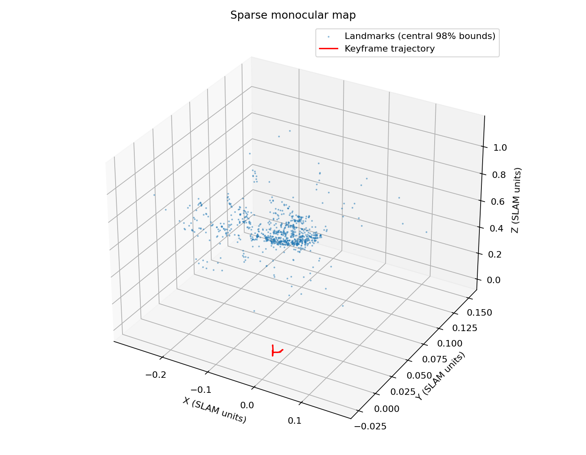
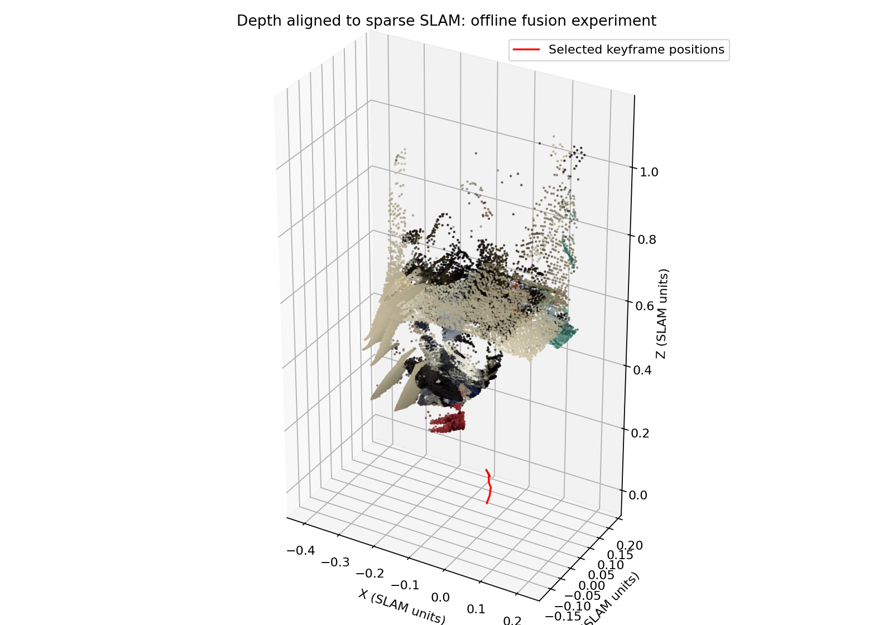
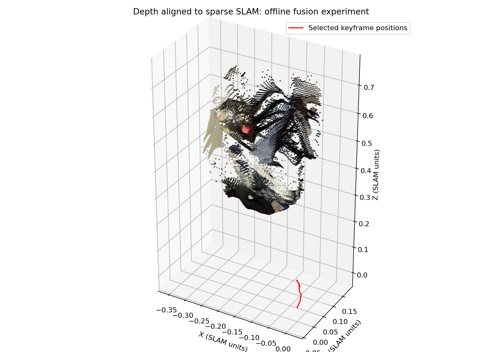

# First calibrated room-recording trials

All three new recordings were processed with stella_vslam using the webcam's
640x480 calibration (`data/calibration.npz`, training RMS 0.106 pixels), not TUM intrinsics.
Calibration used arbitrary checkerboard square units. Reconstruction scale remains
arbitrary. Focus locking is unsupported by this camera driver, so stable intrinsics
across recordings are assumed rather than verified.

| Recording ID | Input frames | Live pose available | Final landmarks |
|---|---:|---:|---:|
| 1793498327387658500 | 150 | 0 (0%) | 0 |
| 1793498363769082900 | 449 | 36 (8.0%) | 0 |
| 1793498406555488000 | 449 | 299 (66.6%) | 866 |

Pose availability includes initialization delays and is not an accuracy metric.
There is no ground-truth trajectory or independently established metric scale.

The first recording never initialized. The second initialized late, then lost
tracking and reset, leaving no final map. The third initialized at 8.37 seconds
and lost tracking near the end (frame 423), retaining 15 keyframes and 866 finite
landmarks with 3,219 validated observation links. It is the best candidate for the
next fusion experiment, but is not a complete or reliably tracked room scan.

Sampled frames show motion blur; the first recording also contains a dark, blurred
close foreground subject. Blank surfaces and limited texture occur in the second.
These are plausible contributors to tracking problems, not isolated causal experiments.
The first clip contains only 150 frames over 30.65 seconds, whereas the others contain
449 frames over approximately 30 seconds. Recorded timestamps are retained.

The runner currently uses the approximately 15.6 FPS configuration derived from the
earlier recording. This is a known mismatch for the sparse first recording and should
be corrected before treating its result as a controlled comparison. The two longer
recordings have similar sampling rates to that configuration.



Artifacts for the third recording are in `data/slam_webcam_1793498406555488000/`:
optimized trajectories, map database, landmarks, observations, tracking diagnostics,
and the run log. This folder contains plot/PLY exports and the three-run summary JSON.

## Offline depth fusion

Fusion now accepts `--calibration` and rejects non-TUM footage without it. It uses
the webcam intrinsics and distortion, correctly adjusted for 320x240 inference.
The original Freiburg defaults remain available only for the named TUM sequence.

The third recording produced **74,325 voxelized colored points** from **10/15
keyframes**. Five late keyframes were skipped for fewer than 40 visible observed
landmarks. Voxel size was 0.002 arbitrary SLAM units, not meters.

Across 543 valid held-out sparse correspondences, mean absolute relative depth error
was **8.13%**, with a median of **3.47%** and zero invalid held-out predictions.
These are sample-weighted agreement measures against the SLAM map, not independent
sensor accuracy. Two late fused keyframes had mean errors of **31.9% and 41.3%**;
the pooled value masks substantial variation between views. The same landmark may
be held out in one view and used for fitting another; evaluation is per view.



The reconstruction is visibly distorted, incomplete, and contains duplicated or
spread surfaces. It is an initial fusion experiment, not a clean room model or a
navigation-ready map. There is no verified metric scale or ground plane.

Full outputs are in `data/fusion_webcam_1793498406555488000/`: PLY point cloud,
compressed point/color arrays, preview, and a per-keyframe report. Reproduce with:

```powershell
python fuse_dataset.py --dataset data/recordings/1793498406555488000 --slam data/slam_webcam_1793498406555488000 --calibration data/calibration.npz --output data/fusion_webcam_1793498406555488000 --max-keyframes 20 --voxel-size 0.002
```

This reads saved images; it does not open the webcam or use a capture backend.
Next work should improve tracking, per-view alignment reliability, and map consistency
before generating a floor occupancy grid.

## Conservative fusion checks

An optional `--quality-checks` mode now uses training correspondences only to:

- Require at least 50 training depth inliers and a 70% depth-inlier fraction.
- Require their convex hull to cover at least 5% of the image.
- Keep dense pixels only inside that hull and within the training inliers' 1st–99th
  percentile network-output range, avoiding unsupported spatial/range extrapolation.

These thresholds are engineering heuristics, not calibrated confidence estimates.
Held-out samples are not inputs to these checks. Both all-fit and accepted-view
held-out statistics are retained in the report to expose selection effects.

| Output | Initial | Conservative |
|---|---:|---:|
| Fused keyframes | 10 | 8 |
| Dense map points | 74,325 | 26,613 |
| Valid held-out samples in retained views | 543 | 497 |
| Mean held-out agreement error in retained views | 8.13% | 7.05% |
| Mean held-out error across all fitted views | 8.13% | 8.13% |

The two early weak alignments were rejected. The two late alignments with 31.9%
and 41.3% held-out errors still pass the training-only checks. The lower pooled
error reflects reduced view coverage, not improved estimates for identical inputs.
Underlying camera tracking was not changed. The new preview is more limited in
extent and still has substantial surface spread/duplication.



Reproduce without changing the original output:

```powershell
python fuse_dataset.py --dataset data/recordings/1793498406555488000 --slam data/slam_webcam_1793498406555488000 --calibration data/calibration.npz --output data/fusion_webcam_refined --max-keyframes 20 --voxel-size 0.002 --quality-checks
```

This remains an offline experiment in arbitrary units, unsuitable for obstacle
avoidance. Further checks need independent validation and temporal consistency.
