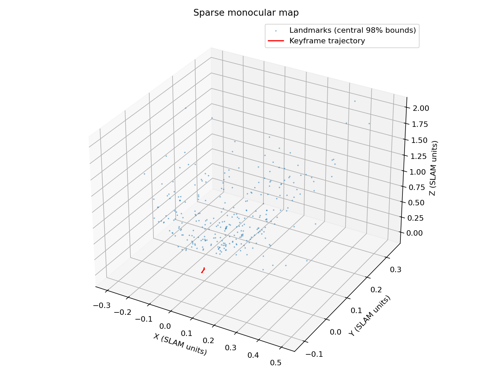

# Static-scene recording check

Recording `1793499467724595200` contains 450 frames at 640x480. Sampled images show
the bed and nearby static objects without the laptop's changing display. It was
processed with the same webcam calibration and SLAM settings as earlier trials.

| Measurement | Result |
|---|---:|
| Live pose available | 273/450 (60.7%) |
| First live pose | 1.41 seconds |
| Final keyframes | 8 |
| Final finite landmarks | 313 |
| Valid keyframe/landmark observation links | 1,068 |

Initialization happened earlier than in the preceding desk recording (6.22 seconds),
but overall tracking coverage was lower. Tracking was lost at frame 293 and did
not recover before the end. Removing screen content alone therefore did not fix
the pipeline. This is not a controlled causal comparison because the scene and
camera path also changed.

## Fusion result

No dense map was produced. Five keyframes failed to establish a positive-scale
inverse-depth alignment with sufficient sparse support. Three had fewer than 40
visible observed landmarks. These failures occurred before the optional quality
gate. The report is at `data/fusion_webcam_static_scene/report.json`.

The recording was successfully saved and processed. The failure is disagreement
between predicted depth and sparse SLAM geometry; there is no isolated evidence yet
that assigns it to one cause. Possible contributors include unstable monocular
geometry, relative-depth model errors, calibration/focus uncertainty, or an
integration issue. Do not attribute it solely to user camera motion.

The next useful work is offline diagnostics of sparse reprojection and coordinate
conventions, calibration sensitivity, and depth/SLAM correspondence distributions.
No additional capture is needed for that investigation. Existing successful TUM
and first-room fusion outputs remain preserved, with no thresholds relaxed to
manufacture a dense map for this clip.

There is no independent ground truth or metric scale for this footage.

Follow-up: [offline diagnosis](../fusion_diagnostics/results.md) checked export
conventions, sparse reprojection, depth ordering, and estimated parallax. A separate
stricter-initialization trial did not resolve the problem and remains experimental.
