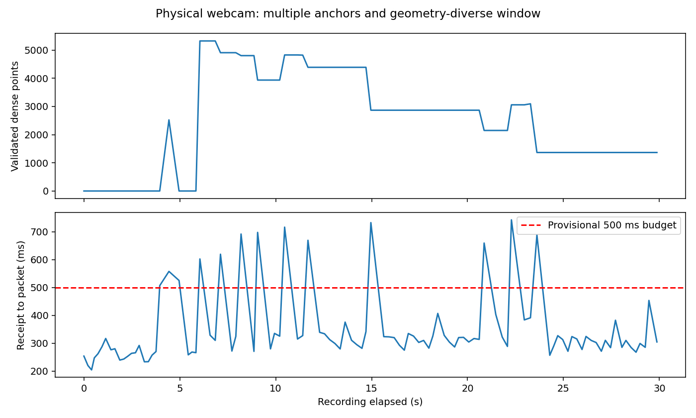

# Successful live geometry-diverse window session

Session `fdcaebe047df439fa60dd00f6e0586c4`, recorded November 1, 2026, ready and
saved without snapshot warnings. Source: physical webcam, DirectShow 640x480 at
requested 15 FPS for 30 seconds, automatic exposure requested, CPU Depth Anything
V2 Small at 224x168. Strict SLAM initialization, multiple cached candidate anchors
and geometry-diverse active window are confirmed in the saved options/states.
All original recording and map files remain unchanged.

| Measurement | Result |
|---|---:|
| Processed outputs | 103 |
| Posed outputs | 84/103 (81.6%) |
| First returned pose | 3.95 s |
| Outputs with validated dense mapping | 79/103 (76.7%) |
| Dense output fraction among posed outputs | 79/84 (94.0%) |
| First / last dense output | 4.43 / 29.87 s |
| Peak supported dense points before combined-map voxelization | 5,323 |
| Final supported dense points before combined-map voxelization | 1,366 |
| Final combined sparse/dense snapshot | 1,671 points |
| Receipt-to-packet median / p95 / p99 | 310 / 687 / 733 ms |
| Misses of provisional 500 ms budget | 13/103 (12.6%) |

Dense coverage was sustained across most posed outputs, but not uninterrupted.
The point count changes as the active geometry and support change. The final
selected views were [2,10,11,12], preserving an older useful view with recent ones.
Their final held-out mean SLAM depth disagreement spans 9.75%–13.52%; these values
describe selected per-keyframe consistency, not independent map accuracy. Rejected
views and unsupported/free-space-conflicting points remain excluded.

## What this establishes

The complete live webcam-to-depth-to-SLAM-to-bounded-dense-window path worked in
this physical-camera test. It is a useful demonstration session and a reference
for regression testing. It is not evidence of a complete persistent room map,
metric depth, accuracy across scenes, or dependable robot-control latency. Hidden
sensor buffering, network transfer and physical display are outside these timing
measurements. One successful run does not establish repeatability.

The saved final map/replay is a snapshot; replaying it does not recreate historical
growing point clouds. Source recording and state timeline are at
`data/sessions/fdcaebe047df439fa60dd00f6e0586c4`.

## Remaining work

Preserve this session as the demo baseline. Prioritize p95 latency and output jitter
while retaining validation quality and coverage. Test changes against this recording
and the prior failed sessions rather than tuning only for successful outputs.
Independent geometry accuracy and repeatability across scenes remain separate
validation tasks. No further camera recording was started for this review.

[Full measurements](measurements.json).
