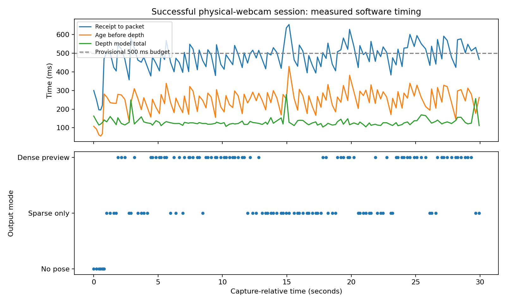

# Depth accuracy, overlap and the next mapping step

Start with the [successful-session report](report.md) and
[saved measurements](measurements.json). The original session and final map were
not overwritten.

## What this session establishes

122/129 processed outputs had a pose; 66 included an accepted local dense preview.
The final snapshot had 1,308 sparse points, because its dense preview was rejected.
The median accepted-output held-out mean disagreement was 8.59%; its 95th percentile
was 14.39%. This is a distribution of per-output means against SLAM, not independent
depth accuracy or a claim about the rejected outputs.

The recorded p95 receipt-to-packet age was 581 ms, with 57/129 misses of the
provisional 500 ms budget. Depth inference was only 122 ms at the median, while
frame age before depth processing was 254 ms. The old timing trace cannot fully
attribute the latter to transport versus result waiting.

## Implemented: lossless transport and instrumentation

Live SLAM now receives lossless raw BGR frames over a bounded request/response
pipe. The old shared-PNG route remains available to the test harness for comparison.
Raw pixels are unchanged: no JPEG compression or neural-model change. Original
frames are still archived, but archival PNG writing is after reply publication.
The reader is buffered, and short binary-pipe writes are handled explicitly.

New stage measurements distinguish image handoff, SLAM tracking, latest-result
waiting, RGB/depth storage, model processing, map construction/export and JPEG
encoding. The dashboard distinguishes **LIVE SPARSE** from **LIVE + DENSE**, and
does not recompute live server-send age after a session completes.

A 20-second timed-input comparison used the same successful recording and 320x240
depth input, with the same model and conservative fusion policy:

| Measurement | PNG handoff | Raw BGR pipe |
|---|---:|---:|
| Median SLAM round trip | 100.7 ms | 26.7 ms |
| Median WSL image input time | 72.9 ms | 3.5 ms |
| Median age before depth worker | 199.2 ms | 85.7 ms |
| Total receipt-to-packet p95 | 900.3 ms | 678.1 ms |
| Outputs / posed outputs / dense previews | 40 / 38 / 36 | 51 / 47 / 30 |

These are timed saved-input runs, not new moving-webcam trials. They have different
processed-frame subsets and asynchronous map histories, so preview counts do not
measure accuracy. Model processing also varied (352 versus 286 ms median); do not
attribute the entire total-latency difference to transport. Background load and
power mode were not controlled; one run per condition is insufficient for a
statistical performance claim. [Detailed transport measurements](transport_comparison.json).

## Tested: smaller input before replacing the model

Depth Anything V2 Small is already the current lightweight baseline. A smaller
model might help speed but could reduce geometric fidelity. First, the same model
was evaluated at three sizes on five uniformly selected retained keyframes from
this session's final map. All sizes used identical sparse training/held-out samples,
and all five fits succeeded. Warm-up was excluded from 15 model-timing samples per
size. Three repeated passes do not add independent quality observations.

| Input | Model p50 / p95 | Pooled held-out mean disagreement | Training-quality supported views |
|---|---:|---:|---:|
| 160x120 | 85 / 90 ms | 11.68% | 3/5 |
| 224x168 | 149 / 159 ms | 8.49% | 5/5 |
| 320x240 | 303 / 379 ms | 8.12% | 5/5 |

The means include all fitted views, including quality rejections, so coverage is
the same here. This uses final optimized geometry and therefore differs from
online transient fits. It is a small selected scene, not ground-truth accuracy or
an independently held-out test set. Full [per-view results](depth_tradeoff.json)
include support fractions, rank correlations and rejected views.

**224x168 is the next experimental setting to try**, rather than changing weights
or reducing input further. Defaults were not silently changed. A further timed
run with raw transfer and 224x168 produced 81 outputs, 73 poses and 66 dense previews;
p95 receipt-to-packet age was 481 ms, with 4/81 misses of 500 ms. This is not proof
of reliable real-camera timing; only one short saved-input run was performed.
[Verification](raw224_verification.json), [timing](raw224_timing.json).

## Overlap: already substantial; baseline matters too

The final map has 16 retained keyframes. The median shared fraction of the smaller
neighboring keyframe's landmark set is about 80%. Increasing overlap indiscriminately
is not the main goal: nearly identical images can have high overlap and little
triangulation leverage.

| Keyframe gap | Median shared landmarks | Median pair's estimated ray angle |
|---|---:|---:|
| Adjacent | 320 | 1.84° |
| Two apart | 215.5 | 3.29° |
| Three apart | 146 | 4.45° |

These are internal estimates from optimized geometry, not measured camera motion
or RGB image-area overlap. They suggest testing nonadjacent but still well-matched
views for depth validation. No SLAM parameters or acceptance gates were tuned from
these numbers. [Pair-by-pair data](overlap.json).

## Next mapping work, not yet implemented

Update: [paired selection/cross-view experiment](../paired_fusion/results.md) is now
complete offline. A [bounded live active-window prototype](../active_keyframe_window/results.md)
is now available as an opt-in mode; it remains experimental and adds latency.

1. Select sharp, well-tracked keyframes with sufficient shared landmarks **and**
   useful ray-angle change. Keep SLAM running between selected fusion frames.
2. Confirm candidate depths in other views, distinguishing occlusion from a true
   free-space contradiction. Report both disagreement and retained coverage.
3. Store accepted depth in keyframe-local coordinates and rebuild an active map
   window with updated SLAM keyframe poses. The present global sparse snapshot plus
   replaceable dense patch is not persistent dense reconstruction.
4. Compare any lighter replacement model on the exact same views, masks and
   training/held-out associations. Include fit failures, boundary quality and
   temporal consistency; do not rank models on FPS or accepted samples alone.
5. Validate accuracy with a measured reference or public ground-truth dataset.
   Zero disagreement is not a realistic goal, and agreement with SLAM cannot prove
   correctness when both estimates share errors.

51 Python tests, four JS protocol tests and browser regressions passed after the
transport/instrumentation changes. No captured pixels or previous maps were replaced.
