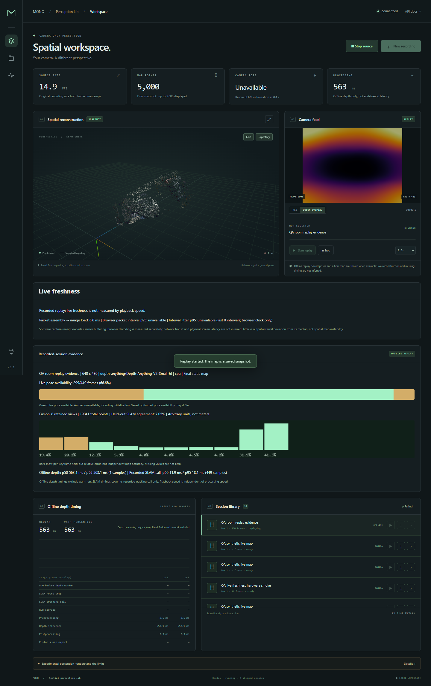

# Webcam reconstruction and replay

Current scope is webcam reconstruction, recorded-session replay, diagnostics and
benchmarks. Gazebo/navigation are excluded from the active deliverable.

## Prepared session

The existing best room recording has been imported as **Room reconstruction -
experimental replay**, session `829c91a18d99475e98ae9488c7fa4ede`.
It contains 150 RGB/depth frame pairs (every third original frame), original
timestamps, 99 associated optimized poses, the 19,041-point final map and copied
tracking/fusion reports. Up to 5,000 map points are displayed by the viewer.
The original input contains 449 frames; live pose availability is 299/449 (66.6%).
Initialization is included in the unavailable fraction. This is not pose accuracy.

Dashboard additions:

- Full-recording pose-availability timeline, separate from saved optimized poses.
- Per-keyframe held-out relative depth errors, with missing results left missing.
- Measured offline depth p50/p95 and recorded SLAM tracking-call p50/p95.
- Model/device/resolution and explicit static-snapshot semantics.
- Saved depth overlay synchronized to the replay sequence; stale overlay images
  are hidden while the next depth frame loads.

Depth is precomputed for replay, not inferred at playback speed. Warm-up is excluded
from saved depth timings. The measured run had depth-total p50 **562.2 ms**, p95
**1006.2 ms**; recorded SLAM-call p50 **11.93 ms**, p95 **18.06 ms**. These are separate
runs, not simultaneous end-to-end measurements. Other background activity was not
controlled, so these are diagnostic samples, not a controlled performance comparison.
Capture, fusion and network stage latencies remain unavailable.

## Reconstruction status

Replay display corrections: the main processing card and stage table now use
saved offline depth timings when available, explicitly excluding end-to-end
latency. Source FPS is derived from original tracking timestamps rather than
playback speed or the subsampled replay count. Session details refresh after
imports finish, and depth sample counts reset when replay restarts, including
restarts triggered outside the browser. Stopped playback is labeled STOPPED;
frames before the first available SLAM pose explain the initialization delay.

The map is still incomplete and distorted. Cross-view filtering does not fix weak
SLAM triangulation. A recognizable, reliable full-room reconstruction is **not**
complete, and no live SLAM/fusion result is claimed.

The saved checkerboard calibration was checked using four train/held-out splits
(18 training and 6 held-out board views each). Focal-length range was **0.445%** of
saved fx; held-out board reprojection RMS was **0.086–0.150 px**. The corner hull
covers 36.7% of the image. This is evidence of stability across these calibration
views, not independent metric accuracy or verification of unchanged webcam focus.
Saved calibration and baseline SLAM outputs were not overwritten.

Reproduce this sensitivity check with `python -m eval.calibration_stability`.
Full results: [calibration_stability.json](fusion_diagnostics/calibration_stability.json).

## Validation

39 Python tests and four JavaScript protocol tests pass. Real Chrome browser QA
passes desktop/mobile layout, replay RGB/poses, depth overlay, source controls and
new evidence panels with the real saved room artifacts. No browser page errors
were observed. QA uses an isolated session store; the user backend is not stopped.

Restart the existing backend to load its new `/sessions/{id}/analysis` endpoint,
hard-refresh the dashboard and select the prepared room session. Completed static
maps are shown immediately; only the camera frame and trajectory progress during
replay. There are no saved incremental map updates.
